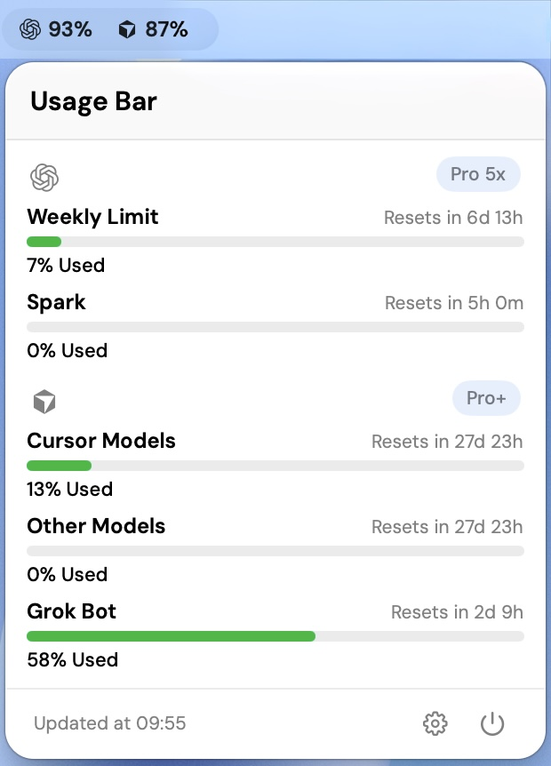

# Usage  Bar

Small macOS menu bar app (SwiftUI) that shows your **Codex** (ChatGPT plan),
**Claude Code** (Anthropic plan), **Cursor**, **OpenCode** and **Command Code**
usage limits: **percentage remaining** and time until reset.

<p align="center">
  
</p>

In the menu bar: `‹ChatGPT logo› 99% ‹Claude logo› 99% ‹Cursor logo› 99%` — the
Codex window with the least left (5-hour or weekly), Claude's binding limit,
then Cursor's **Weekly usage** (the **Cursor Models** pool on legacy Cursor
plans). OpenCode's
**Current session** and Command Code's **Current session** windows can be turned
on in Settings. The popover breaks down every window on each side.

Claude's menu bar value is the first available of: the limit Anthropic marks as
active, **Current session**, **Current week (all models)**, then the most used
per-model weekly limit. Plans without a 5-hour window, such as verified Ultra
accounts, therefore show their weekly percentage instead of `--%`. Usage credits
never drive the menu bar. VoiceOver names the window, for example "Claude weekly
limit, 25 percent left". A window whose reset time passed after the last fetch
shows as full and "Reset, waiting for new data" until fresh data arrives.

Settings has two switches per plan: **Popover** (the plan is fetched and has a
section) and **Menu bar** (a subset of the popover plans). Hiding a plan from
the menu bar no longer stops fetching it. A plan shown in the popover without a
usable sign-in shows one line saying how to sign in.

`MenuBarController` owns a variable-length `NSStatusItem` and a borderless
`NSPanel` that hosts `UsageMenuView`. `MenuBarLabelImage` composes the selected
segments off-screen into one compact template image. Each update replaces
`button.image`, so AppKit grows and shrinks the status item with its content.
Do not reserve hidden text or set a numeric status item length. Regression tests
cover compact image bounds and bidirectional resizing on the same status item.

## Install

macOS 14 or newer, Apple Silicon and Intel. The GitHub zip is a **universal
binary**. The app installs into **Applications** as `/Applications/UsageBar.app`
(Finder shows **Usage Bar**). It runs in the menu bar only — no Dock icon.

### Option 1 — GitHub release (no Xcode)

1. Open the [latest release](https://github.com/DailyXplorer/Usage-Bar/releases/latest).
2. Download **`UsageBar.app.zip`**.
3. Unzip it.
4. Drag **Usage Bar** into **Applications**.
5. Open it from Applications.

If macOS refuses the first launch (ad-hoc signature), in Finder:
**right-click → Open**.

### Option 2 — checksum-verified installer script

```sh
curl -fsSLo UsageBar-install.sh https://raw.githubusercontent.com/DailyXplorer/Usage-Bar/main/scripts/install.sh
less UsageBar-install.sh
sh UsageBar-install.sh
rm UsageBar-install.sh
```

Inspect the downloaded script before running it. It verifies the release
tag once, downloads both assets from that exact tagged release, then checks the
SHA-256 file, bundle identifier, executable name, and ad-hoc code signature. It
stages the replacement in Applications with rollback before launching it and
stops a running Usage Bar first, so installation cannot leave two menu bar
instances.

### After install

- Open the popover from the menu bar icon.
- **Settings…** → **Launch at login** to start Usage Bar when you log in.
- **Settings…** → **Updates** to check GitHub or turn on automatic installs.
  When a newer release exists, an **Update** button also appears in the popover.
  Automatic checks are on by default (once a day at launch and at most every
  6 hours when the popover opens); automatic installation requires opt-in. A
  failed automatic install waits before retrying the same version.
- Press ⌘Q while the popover is open to close it; quit Usage Bar with the power
  button in the popover.

You need a Codex CLI login (`codex login`) for ChatGPT limits, a Claude Code
login for Anthropic limits, a signed-in Cursor editor or a Cursor session token
in Settings for Cursor limits, an
`opencode-go` API key (`/connect` → OpenCode Go) for OpenCode limits, and a
Command Code login (`cmd login`) for Command Code limits. On first launch the
popover and menu bar show the plans whose sign-in Usage Bar finds (Codex and
Claude when it finds none). A plan you turn on without a sign-in shows how to
sign in.

### From source

Needs [Xcode Command Line Tools](https://developer.apple.com/download/all/?q=command%20line%20tools):

```sh
git clone https://github.com/DailyXplorer/Usage-Bar.git
cd Usage-Bar
chmod +x scripts/build-app.sh
scripts/build-app.sh
```

That compiles a release build and installs `/Applications/UsageBar.app`.

```sh
scripts/build-app.sh --no-install          # only .build/UsageBar.app
scripts/build-app.sh --no-install --zip    # also zip + .sha256 release assets
swift test                                 # unit tests
swift build && ./.build/debug/UsageBar     # debug binary, not the .app
```

Contributors: start with [CONTRIBUTING.md](CONTRIBUTING.md). Naming for
branches, commits, and pull requests is in [CONVENTIONS.md](CONVENTIONS.md).
Agent workflow, tests, and GitHub releases are in [AGENTS.md](AGENTS.md).

## How it works

### Codex

- Reads `$CODEX_HOME/auth.json` when `CODEX_HOME` is set, otherwise
  `~/.codex/auth.json` (the same file the Codex CLI uses), to get the ChatGPT
  `access_token` and `account_id`. Usage Bar never renews the Codex token: when
  its expiry has passed, the section says "Codex sign-in expired. Open Codex to
  renew it." without calling the server.
- Queries the official endpoint `https://chatgpt.com/backend-api/wham/usage`
  (the same one `codex /status` uses).
- Shows the primary window (**Current Session**, **Weekly Limit**, … depending
  on the duration the backend returns, same heuristic as the CLI) and the
  secondary window when present. Pro accounts may have only a weekly window.
- Every extra limit ChatGPT returns in `additional_rate_limits` gets its own
  row named after the limit. **Credits** shows the balance (or "Unlimited"),
  and a workspace spending cap shows as **Monthly Credit Limit**. These rows
  stay out of the menu bar.

### Claude Code

- Reads the OAuth token from the macOS keychain through `/usr/bin/security`,
  exactly the way Claude Code writes it — that is what avoids a keychain
  authorization prompt on every launch. Falls back to
  `~/.claude/.credentials.json`. No token is ever copied elsewhere. Every
  `security` call has a time limit, so a locked keychain cannot stall refreshes.
- When that token has expired, or the usage endpoint rejects it, renews it once
  the way Claude Code does, through `https://platform.claude.com/v1/oauth/token`,
  and saves it back to the same keychain entry or file. It first takes Claude
  Code's own refresh locks, re-reads the entry just before writing, keeps a
  newer token Claude Code wrote meanwhile, and changes only the token fields.
- Usage comes from three sources, in this order:
  1. **Claude Code's saved copy**: `cachedUsageUtilization` in `~/.claude.json`,
     when it is at most one hour old, belongs to the signed-in account and is
     newer than Usage Bar's own data. No network request.
  2. **The usage endpoint** `https://api.anthropic.com/api/oauth/usage`, called
     with Claude Code's request shape. Background refresh runs at most every
     15 minutes. Opening the popover refetches only when the data is older than
     5 minutes and the last call was at least a minute ago; the refresh button
     follows the same one-minute floor.
  3. **Optional quota check** (Settings → Claude, off by default): while
     Anthropic pauses the usage endpoint, Usage Bar can send, at most every
     15 minutes, the same one-token request Claude Code sends at startup and
     read the session and weekly limits from its response headers. That request
     counts toward your Claude plan. It cannot see per-model weekly limits, so
     those rows keep their last values.
- When the usage endpoint answers 429, Usage Bar pauses it until `Retry-After`,
  or 5, 15, 30 then 60 minutes on repeated 429s, never more than an hour. The
  pause is stored per Claude account and survives a restart; the refresh button
  does not skip it. The Claude section keeps the last values and says
  "Anthropic paused usage updates. Showing values from ‹time›. Next try at
  ‹time›." Times read like "at 00:19" in your 12- or 24-hour format, with
  "tomorrow" or a short weekday when they are not today.
- Mirrors Claude Code's `/usage` rows: **Current session** (only when the plan
  has a 5-hour window), **Current week (all models)** and
  **Current week (‹model›)** for per-model weekly limits such as Fable. Other
  limit kinds Anthropic adds appear with a readable name. **Usage credits**
  (spent / monthly limit) and Claude credit windows appear when enabled.
- The plan badge comes from Anthropic's profile (for example **Claude Ultra**),
  checked at most once a day, else from the sign-in's plan fields. When the
  usage comes from Claude Code's saved copy or the quota check, the badge uses the profile name
  already stored for that account, or the sign-in's plan fields; Usage Bar
  sends no profile request then.
- If there is no Claude Code session, the section says how to sign in.

### Cursor

Cursor and Grok share one account since The X Subscription. Usage Bar supports
both account shapes:

- **Unified accounts** (Cursor and Grok combined): one **Weekly usage** bar for
  the shared weekly pool, with its reset time and the plan name as the badge.
  When the account has a monthly additional-usage limit, an
  **Additional usage** row shows `$used / $limit`. The menu bar shows the weekly
  pool. While Cursor is still merging the accounts, the section says
  **Account merge in progress** instead of showing an empty bar.
- **Legacy Cursor plans**: **Cursor Models** (Cursor Grok and Composer) and
  **Other Models** (third-party models billed at API rates). On weekly plans
  the reset comes from Cursor's plan details, otherwise from the billing cycle.
  A **Grok Bot** bar appears only when the account still has a separate,
  non-zero Grok Bot allowance. The menu bar shows the Cursor Models pool.

Requests: `GetSandUsageStatus` and `GetCurrentPeriodUsage` on
`https://api2.cursor.sh/aiserver.v1.DashboardService/`, plus `GetPlanInfo` for
legacy accounts (cached for an hour). All three use the same Cursor token and
are made together, once per refresh.

Sign-in sources, first usable one wins:

1. The Cursor editor's saved sign-in in
   `~/Library/Application Support/Cursor/User/globalStorage/state.vscdb`
   (`cursorAuth/accessToken`), opened read-only. Cursor 3.27 and later encrypt
   that value; Usage Bar decrypts it with the **Cursor Safe Storage** Keychain
   item, which macOS may ask you to allow once.
2. A **Cursor session token** pasted in **Settings** → **Cursor**: sign in at
   cursor.com in your browser, open its developer tools, and copy the
   `WorkosCursorSessionToken` cookie under Cookies for cursor.com. The value
   (`user_…%3A%3A…`), the `name=value` pair or the whole `Cookie:` line all
   work; Usage Bar keeps only the access token, in its own Keychain item. A
   value that is not a Cursor session token, or one that has expired, is
   refused with a short message.

The Grok Bot app's sign-in is not read: its sealed files belong to its local
agent, not to your account, and its token store is internal to the app (see
[docs/DECISIONS.md](docs/DECISIONS.md)). Usage Bar never renews a Cursor or
Grok token. When no source works, the section says how to sign in.

### OpenCode

- Reads the `opencode-go` API key from OpenCode's database, `opencode.db`
  (`$OPENCODE_DB`, else under `$XDG_DATA_HOME/opencode`,
  `~/.local/share/opencode` or `~/Library/Application Support/opencode`),
  opened read-only. Falls back to the legacy
  `auth.json` in the same folders. No key is ever copied or rewritten.
- Queries `https://opencode.ai/zen/go/v1/usage`, the official Go quota endpoint,
  with the same Bearer key the TUI already uses.
- Mirrors the three Go windows: **Current session** (5 hours), **Weekly** and
  **Monthly**, each with its reset time. The menu bar shows the current
  session window.
- If there is no `opencode-go` key, the menu bar segment stays hidden and the
  popover section says how to add one.

### Command Code

- Reads the API key the Command Code CLI writes to `~/.commandcode/auth.json`
  on `cmd login` (`apiKey`). `COMMAND_CODE_API_KEY` (or `COMMANDCODE_API_KEY`)
  overrides that file when set. No key is ever copied or rewritten.
- Queries the same `/alpha` endpoints the CLI `/usage` view uses on
  `api.commandcode.ai`: `whoami?limits=1` → `billing/subscriptions` →
  `billing/credits` → `usage/summary`.
- Shows **Current session** (5-hour cap) and **Weekly** when the plan has
  rolling windows, and **Monthly** with the CLI's formula: your remaining
  monthly, purchased and free credits against the plan's monthly credits
  (or credits spent plus what is left when the subscription is not active).
  The menu bar shows the current session window.
- Organization spend caps appear as extra rows, for example
  **Org-wide spend limit** with `$spent of $limit/mo`.
- Plan badge, as in the CLI: **Go**, **GOAT**, **Pro**, **Provider**, **Max**,
  **Ultra**, **Teams Pro**.
- If there is no Command Code key, the menu bar segment stays hidden and the
  popover section says how to sign in.

All accounts are queried in parallel: a slow backend does not block the others,
and an error on one side does not wipe out the other sides' bars.

### Going easy on the endpoints

Each provider shown in the popover refreshes on its own schedule after its
previous request completes: Codex every 3 minutes, Claude every 15 minutes,
Cursor, OpenCode and Command Code every 5 minutes. Opening the popover fetches
only data that is due (Claude: see above). Every provider request goes through
a session with no URL cache and no cookies, so a cached reply is never
replayed. Polling stops during sleep and in-flight replies are dropped. No
request starts while macOS reports no network; when the network comes back,
due data is fetched at once. A network failure in the first minute after wake
is retried quietly every 15 seconds instead of shown.

- The last values and each endpoint's successful fetch time are persisted in
  `UserDefaults`, so the popover can show saved data while a refresh is pending.
  Saved rows whose window ended long ago are dropped on launch.
- **Refresh usage** can bypass the normal interval (Claude: at most once a
  minute), but never an active rate-limit pause. Requests to the same endpoint
  cannot overlap.
- All providers respect HTTP 429 with progressive backoff (5 → 15 → 30 → 60 min)
  or the server's `Retry-After`. Every pause is capped at 60 minutes, survives
  an app restart and expires on its own.
- Command Code caches subscription details for up to 30 minutes, expiring
  sooner at the known billing-period end. Account details, spend limits and
  credits stay live; the optional summary has its own retry delay and its
  amounts are never cached.

The popover footer shows when data last arrived ("Updated 2 min ago").
Each section's timestamp belongs to its own data. Failed reads, or data older
than twice its refresh interval, show **Saved data** without making another
provider appear fresh. Older saved data
without a reliable per-provider timestamp stays marked as pending until its
first successful refresh.

The menu and menu bar both show **% remaining** (66% left means 34% used).
Countdowns use absolute reset times and update once a minute while the menu is
open. Missing reset times are omitted until a response supplies a reliable date.

## Design

- English interface.
- **DM Sans** typeface from Google Fonts (variable, bundled in the app),
  including for the menu bar label. `AppTheme.nsFont` applies optical sizing
  through the `opsz` axis (clamped to the supported 9–40 range) and weights
  through the `wght` axis.
- Provider logomarks (ChatGPT logo for Codex, Claude spark, Cursor cube,
  OpenCode **O**, Command Code command symbol) are bundled as SVG and rendered
  as templates so they follow the menu bar theme. They are optically padded to
  read at the same size in the 12 px menu bar label and 16 px Settings row.
  **Hugeicons** `dashboard-speed-02` is the application icon.

## Requirements

- macOS 14+ (Sonoma or newer), Apple Silicon and Intel
- Signed in to the Codex CLI with a ChatGPT account: `codex login`
- For the Claude side: signed in to Claude Code (`claude`, then `/login`)
- For the Cursor side: signed in to the Cursor editor, or a Cursor session
  token pasted in Settings
- For the OpenCode side: an `opencode-go` key (`/connect` → OpenCode Go)
- For the Command Code side: signed in to the Command Code CLI (`cmd login`)
- To **build from source**: Xcode Command Line Tools (`xcode-select --install`)

## Notes

- The app runs as an accessory agent: no Dock icon, menu bar only.
- Before installation, the archive must match the SHA-256 published beside it,
  both asset URLs must belong to the same tagged Usage Bar release, and
  code-signing verification checks the extracted app’s integrity. The
  signature is ad hoc, not a Developer ID identity: it does not authenticate a
  publisher. GitHub over HTTPS and the installer script you inspect remain the
  trusted distribution channel.
- No data leaves your machine beyond the usage requests to chatgpt.com,
  api.anthropic.com, platform.claude.com (Claude sign-in renewal),
  api2.cursor.sh, opencode.ai and api.commandcode.ai,
  identical to the ones the CLIs, Cursor, OpenCode and Command Code themselves
  make, and the optional GitHub Releases check for updates.
- **Keychain**: the `Claude Code-credentials` entry is created by Claude Code
  through `/usr/bin/security`, so its ACL only trusts that binary. The app goes
  through the same path to read it and to save a renewed token: no
  authorization prompt, including after a rebuild
  (the app is ad-hoc signed, so its signature changes every time).
- The Claude token is renewed by Usage Bar when it expires, the same way Claude
  Code renews it, so Claude Code keeps working with the new token. If the
  renewal is refused, the section shows "Claude Code sign-in expired" until
  you run `claude`, then `/login`.
- With the optional Claude quota check turned on, Usage Bar also calls
  `api.anthropic.com/v1/messages` with a one-token request while the usage
  endpoint is paused.
- The Cursor token is read from the Cursor editor's sign-in or from the token
  saved in Settings. If it has expired, the section says so until Cursor
  renews it or you paste a new token. Usage Bar does not renew it.
- The `opencode-go` key is read from OpenCode's local database or `auth.json`.
  If it is missing or rejected, the section says how to add one or that the
  key is invalid until the next `/connect`.
- The Command Code key is read from `~/.commandcode/auth.json`. If it is
  missing or rejected, the section says how to sign in or that the key is
  invalid until the next `cmd login`.

## License

The code in this project is licensed under the **MIT** license — see
[LICENSE](LICENSE).

Bundled third-party assets keep their own:

- **DM Sans** (`Sources/UsageBar/Resources/Fonts/DMSans.ttf`) — © 2014 The DM
  Sans Project Authors, under the
  [SIL Open Font License 1.1](https://openfontlicense.org). The license ships
  alongside the font
  ([`Fonts/OFL.txt`](Sources/UsageBar/Resources/Fonts/OFL.txt)), as the OFL
  requires: if you redistribute the app or the repo, keep that file next to the
  `.ttf`.
- **Hugeicons** (`Support/AppIcon.svg`) — `dashboard-speed-02` from the free
  set, MIT licensed, no attribution required.

The ChatGPT, Claude, Cursor, OpenCode, and Command Code logos remain the
property of their respective owners; they are used here to identify
the services being queried, not to imply any affiliation. This project is
affiliated with neither OpenAI, Anthropic, Cursor, OpenCode nor Command Code.
